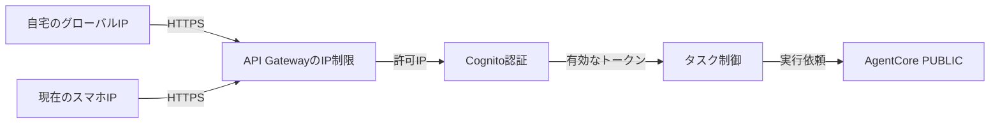

# 個人用エージェントの設計

## 許可した回線から本人だけが操作する



API Gatewayのリソースポリシーで、許可IP以外を明示的に拒否します。
Task APIと画面用の補助APIの両方へ、全ステージ、全パス、全メソッドを対象に適用します。
IPが許可されても各メソッドの認証は必要です。通常のWeb操作にはCognitoを使用します。
Cognitoの自己登録は無効にし、管理者が本人だけを登録します。
IPは回線の制限であり、本人確認の代わりにはしません。キャリアのIPv4を他人と共有する場合もあります。

CloudFrontの静的画面とCognitoの認証エンドポイントは、このAPIポリシーの対象外です。
署名付きURLや他のAWSサービスにも、それぞれの認証と有効期限が適用されます。
IP制限はAWS全体の請求額を保証する上限ではありません。
仕様: [API Gatewayのリソースポリシー](https://docs.aws.amazon.com/apigateway/latest/developerguide/apigateway-resource-policies-examples.html)。

## 変動するスマホIPだけを差し替える

設定の正本はGit管理外の `cdk/cdk.json` です。

```json
{
  "allowedSourceIps": {
    "home": [],
    "mobile": []
  }
}
```

`home` と `mobile` に、実際のグローバルIPv4 `/32` またはIPv6 `/128` を設定します。
両方が空の場合、無効なアドレスの場合、広いCIDRの場合は合成を停止します。
キャリア全体を許可する範囲設定は受け付けません。

1. スマホのWi-Fiを切り、キャリア回線で現在の送信元グローバルIPを確認します。
2. `home` は維持し、`mobile` の古いIPを新しいIPに置き換えます。
3. CDK diffで両APIの変更を確認します。
4. CDK deployでリソースポリシーとステージを更新します。
5. スマホからの操作と許可外の回線からの拒否を確認します。

IP変更時はDeploymentも更新されるよう、許可IPをDeploymentのLogical ID生成情報へ含めています。
設定を編集しただけでは実環境には反映されません。
IPを変更する管理端末の送信元IPを、スマホのIPとして誤って登録しないでください。
実装: [source-ip-policy.ts](../../cdk/src/deployment/source-ip-policy.ts)。

## 使わない運用基盤を作らない

| 作らないもの | 代わりに利用するもの |
|---|---|
| 顧客VPC、NAT、VPC Endpoint、DNS Firewall | AgentCore PUBLICネットワーク |
| WAF | API Gateway標準のIP制限と認証 |
| CloudWatch Dashboard | 独自Web UI |
| CloudWatchアラーム、通知用SNSとKMSキー | UI、ログ、DLQの手動確認 |
| Slack、Linear、Jira連携 | 独自Web UIとCLI |

PUBLICはネットワーク方式の名称であり、認証を無効にする意味ではありません。
タスクの状態、承認、予算チェック、運用ログは残します。
新規のCloudWatch LogsはLambdaの内部プロバイダーも含めて保持期間を180日に明示します。
1タスク1ドルの設定は同梱リポジトリのモデル利用予算であり、処理途中の超過やAWSの他サービスの費用を止める上限ではありません。
独自の定期タスク投入やスマホIPの自動更新は含めていません。

## ローカル試験と実環境の検証を分ける

合成テストではIP制限、空設定の拒否、スマホIP変更時の再デプロイ、アラームや通知リソースがないことを確認します。
合成試験ではLambdaバンドルを省略しており、Dockerイメージや実AWS上の動作を保証するものではありません。
デプロイ後は許可IP、認証、GitHubの権限、モデル利用、予算制御を実通信で確認してください。

対象リポジトリを後で決める場合は、contextの `blueprintRepo` を `false` にして基盤のみをデプロイできます。リポジトリを選んだら `owner/repository` に変更して再デプロイし、GitHub用Secretを設定します。
